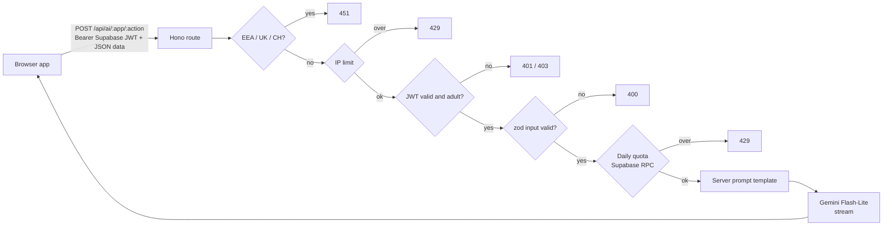
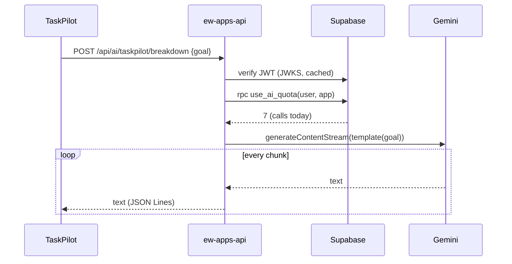

<div align="center">

# ew-apps-api

**One small server behind all seven EW apps.**

[](https://github.com/emwil23/ew-apps-api/actions/workflows/ci.yml)


</div>

## The idea

Seven apps, one $7 Heroku dyno. Each app gets AI features without ever holding an API key or sending a raw prompt: the browser sends plain data (a goal, a list of tasks), and the server turns it into a prompt from a template it owns.

## How it is built





## Decisions worth explaining

- **Templates live on the server.** Clients send typed data that zod checks and caps; any other field is dropped. A client can't turn the key into a general chatbot.
- **Streaming, with a 25s stop.** Heroku's router drops a request that sends nothing for 30s. Streaming sends bytes early; the model is aborted at 25s.
- **JSON Lines output.** Lists (subtasks, time blocks) stream one object per line, so the app shows each item as it arrives.
- **The region block is on the server.** The Gemini free tier can't serve the EEA, UK or Switzerland, so the API looks up the country of the IP that Heroku's router saw (the last `X-Forwarded-For` entry; earlier ones can be forged).
- **The quota is one atomic SQL statement.** `use_ai_quota` upserts and returns the count, so two parallel calls can't both slip under the limit.
- **The IP limit is in memory.** One dyno means one process. If it ever scales out, move it to Postgres.
- **Stock photos go through the server.** `GET /api/photos/:source/search` (Unsplash, Pexels, Openverse) keeps the keys off the client and returns one photo shape for all three. Results are cached for an hour in memory: Pexels allows 200 calls an hour and anonymous Openverse 200 a day, shared by every user. Image URLs still point at each source's CDN, as Unsplash requires, and `POST /api/photos/unsplash/download` reports exports to Unsplash.
- **A private GitHub profile counter.** `GET /api/hits/github-profile.svg` is an invisible 1×1 image in the owner's profile README. Each fetch adds one to today's row in `profile_views` (UTC days, readable only with the service role) and is sent uncached, so GitHub's image proxy fetches it on every profile view. It counts views, not people, and the image never fails: a database error is only logged.
- **The AI only sees public stock photos.** Pixe's `describe` action takes a photo URL, which must be on `images.unsplash.com`, `images.pexels.com` or Openverse's thumbnail host over https; the server fetches a 512px copy (no redirects) and sends it inline. Users' own uploads never reach the free-tier model.
- **Daily ping.** Supabase pauses idle free projects, so the server calls `ping()` once a day.

## Run it

```bash
npm install
cp .env.example .env   # fill in the Gemini key and Supabase values
npm run dev
```

Apply `supabase/migrations/0001_ai_quota.sql` in the Supabase SQL editor once. Then run `npm test`, `npm run lint` and `npm run typecheck`.

Deploy: `git push heroku main`, with the `.env` values set as Heroku config vars.

## Where things are

| Path                   | What                                                                      |
| ---------------------- | ------------------------------------------------------------------------- |
| `src/app.ts`           | The route, its guards and streaming (pure, takes its dependencies)        |
| `src/server.ts`        | Real dependencies: Gemini, Supabase, JWKS, geo-IP; env checks; daily ping |
| `src/apps/`            | One file of prompt templates and input schemas per app                    |
| `src/photos.ts`        | Photo search per source, the shared photo shape, cache, image fetching    |
| `supabase/migrations/` | The quota table and RPCs                                                  |
| `test/`                | Route tests with fake dependencies                                        |

<div align="center">Made with ♥ by EWSTUDIOS</div>
